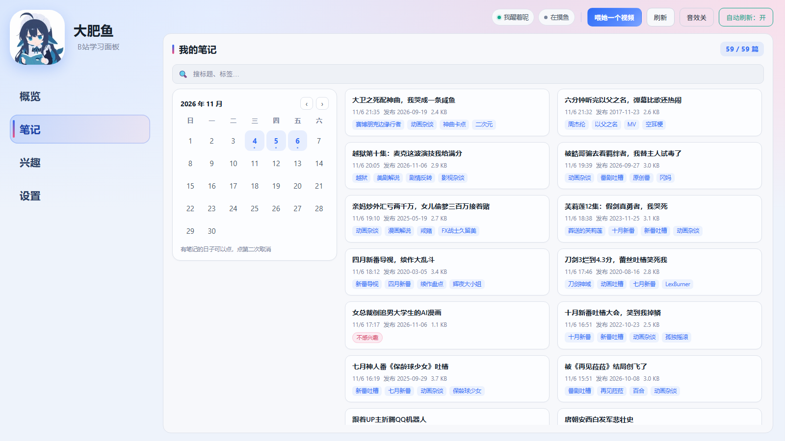
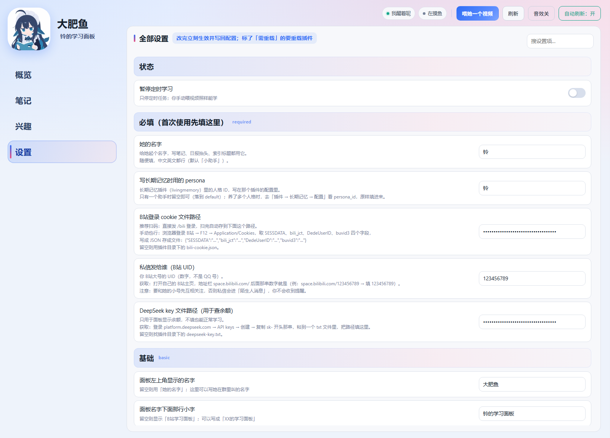

# B站学习助手（astrbot_plugin_bili）

让她用自己的 B 站小号**自主学习**：自己选题、看视频、写笔记、把收获写进长期记忆，再主动分享给你。

默认是「干跑模式」——只学、只写笔记，不点赞不投币不私信，确认没问题再开。

## 功能

- **自主选题**：按配置的时段和轮次自己找视频（可限制每天几个、两轮间隔、免打扰时段）
- **真的在看**：优先 B 站字幕；字幕缺失或疑似串台时，用 `faster-whisper` 本地转写音频（CPU 也能跑）
- **写笔记**：每篇包含摘要、UP 主、发布/记录时间、数据、标签、讲了什么、主要知识点、我的感受
- **兴趣体系**：种子兴趣（带权重）+ 自我拓展；命中加分、跑题减分，会随着学习慢慢漂移
- **探索轮**：每 N 轮从弱兴趣里抽词去探索，避免越学越窄
- **长期记忆**：装了 `astrbot_plugin_livingmemory` 就把笔记写进记忆库；没装自动跳过
- **分享**：QQ 汇报 / B 站私信（可关闭、可限额）/ 语音汇报（需要 TTS 插件）
- **日报**：每天收工后发一张「今日笔记」图 + 一句话（可配时间）
- **互动**：点赞 / 投币 / 收藏，各自有每日限额，收藏可以指定收藏夹
- **Web 面板**：独立网页（默认端口 4123），看数据 / 喂视频 / 改设置，详见下面「面板怎么打开」





## 安装

1. 在 AstrBot 后台 → **插件** → **从文件安装**，选择 `astrbot_plugin_bili-x.y.z.zip`
2. 首次加载会自动安装 `requirements.txt` 里的依赖（`bilibili-api-python`、`faster-whisper` 等）
   - 国内网络慢的话，在设置里把 **HuggingFace 镜像** 填成 `https://hf-mirror.com`
3. 重载插件，进入 **设置 → B站学习** 完成配置

## ⚠️ 先填必填项（不做的话大概率跑不起来）

打开「B站学习 → 设置 → 必填」，这五项在面板里都有说明，这里再写一遍怎么拿到：

| 配置 | 怎么获取 | 不填会怎样 |
|---|---|---|
| 她的名字 | 随便起，写笔记、日报抬头、索引标题都用它 | 笔记落款是「小助手」 |
| 长期记忆用的 persona | 长期记忆插件（livingmemory）配置里的 `persona_id`；只养一个助手就留空 | 记忆写到 `default` 人格下 |
| B站登录 cookie 路径 | **推荐**：直接发 `/bili 登录` 扫码，自动存好；手动：浏览器登录 B站 → F12 → Application/Cookies，取 `SESSDATA`、`bili_jct`、`DedeUserID`、`buvid3` 存成 JSON | 搜不了视频、发不了私信 |
| 私信发给谁（B站 UID） | 打开自己的 B站主页，地址栏 `space.bilibili.com/` 后面那串数字 | 学完不发私信 |
| DeepSeek key 路径 | 登录 platform.deepseek.com → API keys → 创建，把 `sk-` 开头那串存成 txt | 面板不显示余额，其他照常 |

> 私信还有个前提：你的 B站大号要和她的小号**先互相关注**，否则私信会进「陌生人消息」，界面不提醒。

## 兴趣方向怎么选

**第一次装不用配也能跑**：`interest_topics` 默认是空的，面板的「兴趣」页会弹一张引导卡，按方向勾选（动漫 / 影视 / 游戏 / 科技 / 知识 / 音乐 / 生活 / 运动 / 二次元）点「保存并开始」，就自动展开成带权重的种子词。

不选也行——点「先让她自己探索」，她会从 B站热门里随便学几天，学出来的标签会以每轮 ×0.94、连续 3 次命中才留下的方式自然长成「自己拓展的」，权重到 2.0 就转正成种子。

想改方向，随时点右下角「重新选方向」；想从零开始，点「重置兴趣」（会清空种子、拓展词和自学权重，笔记不受影响）。

## 🖥 面板怎么打开

插件自带一个网页面板（看数据、喂视频、改设置都在这里），**不在 AstrBot 的后台菜单里**，要单独开：

### 1. 先打开开关

AstrBot 后台 → 插件 → B站学习 → 配置，找到「开独立面板网页」→ 打开；
下面的「独立面板端口」默认 `4123`，被占用就换一个（比如 `4124`）。

改完**重载一次插件**（插件卡片上的刷新按钮），日志里会出现：

```
[B站学习] 独立面板已启动: http://127.0.0.1:4123
```

### 2. 浏览器打开

| 你的 AstrBot 装在哪 | 地址 |
|---|---|
| 自己电脑（最常见） | `http://127.0.0.1:4123` |
| 同一台机器但想用手机看 | `http://电脑的局域网IP:4123`（如 `192.168.1.20:4123`，需同一 WiFi） |
| 云服务器 | `http://服务器公网IP:4123`，并确认安全组/防火墙放行该端口 |

### 3. 面板里有什么

| 页签 | 能干什么 |
|---|---|
| 概览 | 今天的视频/笔记/token/私信数，今天看的清单（点开看笔记全文） |
| 笔记 | 日历筛选、搜索、翻全文、删笔记（可勾「连记忆」一起删） |
| 兴趣 | 种子兴趣与自动拓展的权重，可直接加减、改权重、加新词 |
| 设置 | 全部配置项，改完即时生效（标「需重载」的要重载插件） |

### 打不开怎么办

| 现象 | 原因 / 处理 |
|---|---|
| `ERR_CONNECTION_REFUSED` | 开关没开、插件没重载，或端口不是 4123（看日志里那行） |
| 页面出来了但数据是 0 / 一直转圈 | AstrBot 没起或刚重启；先等 10 秒再刷新 |
| 云服务器上打不开 | 端口没放行（安全组/防火墙），或面板只监听了 127.0.0.1（换用 SSH 隧道：`ssh -L 4123:127.0.0.1:4123 user@server`） |
| 端口冲突换过端口 | 地址也要跟着换，认日志里打印的实际端口 |

> 不想开面板也行：所有功能都能用 QQ 命令完成（见下面的「命令」），面板只是更直观。

## 首次配置

| 配置项 | 说明 |
| --- | --- |
| `bot_name` | 她的名字（笔记里的第一人称、日报抬头都用它） |
| `memory_persona` | 写记忆时用的人格 ID（默认 `default`） |
| `cookie_path` | B 站登录凭证 json 路径，留空则用插件目录下的 `bili-cookie.json` |
| `dry_run` | 干跑：只学只写笔记，不互动、不私信 |
| `notes_dir` | 笔记根目录，默认插件目录下的 `notes/` |
| `whisper_model` | `tiny/base/small/medium/large-v3` 或本地模型目录 |
| `whisper_threads` | 转写用几个 CPU 线程，0 = 自动（核数/4，最多 8） |
| `deepseek_key_path` | 可选：一个只放 API Key 的文本文件（用于语音/文本模型，留空则用 AstrBot 的模型提供商） |

登录：私聊发 `/bili 登录`，扫码即可（会保存到 `cookie_path`）。

## 命令

| 命令 | 作用 |
| --- | --- |
| `/bili 学 [关键词]` | 立刻学一个（不给关键词就自己找） |
| `/bili 学 BV号` | 学指定视频（会写完整笔记，不受门槛限制） |
| `/bili 重跑 BV号` | 重跑某个视频（`-r` 只看不写） |
| `/bili 笔记 [关键词]` | 查笔记 |
| `/bili 日报 [全部]` | 现在就把今天的汇总发出来（加「全部」带完整清单） |
| `/bili 全部` | 今日笔记清单 |
| `/bili 兴趣` | 看当前兴趣权重 |
| `/bili 面板` | 打开学习面板 |
| `/bili 登录` / `/bili 状态` / `/bili 帮助` | 登录、状态、帮助 |

> 需要 @ 或在消息前加唤醒前缀（默认 `/`），具体看 AstrBot 的平台设置。

## 依赖说明

- `bilibili-api-python`：搜索、视频详情、字幕、点赞投币收藏、私信
- `faster-whisper`：本地语音转写（首次使用会自动下载模型，`medium` 约 1.5 GB）
- `pycryptodomex`：bilibili-api 的签名依赖
- `pillow` / `numpy` / `qrcode`：日报配图、二维码

## 数据放在哪

```
<插件目录>/
  notes/            # 笔记 md + index.md
  notes/state.json  # 兴趣权重、运行计数、兴趣统计
  notes/activity.log
  bili-cookie.json  # 如果没配 cookie_path
```

## 常见问题

**Q：语音汇报没声音？**
需要 AstrBot 配好 TTS 提供商；本插件只负责调 `tts` 生成语音并发送。

**Q：转写很慢 / 电脑卡？**
把 `whisper_model` 换成 `small`，或把 `whisper_threads` 调低（默认最多 8 线程）。

**Q：模型下载失败？**
设置 → 内容处理 → **HuggingFace 镜像** 填 `https://hf-mirror.com`。

**Q：B 站请求 412 / 风控？**
降低每日轮次、加大两轮间隔；登录态过期重新 `/bili 登录`。

## 许可

MIT
