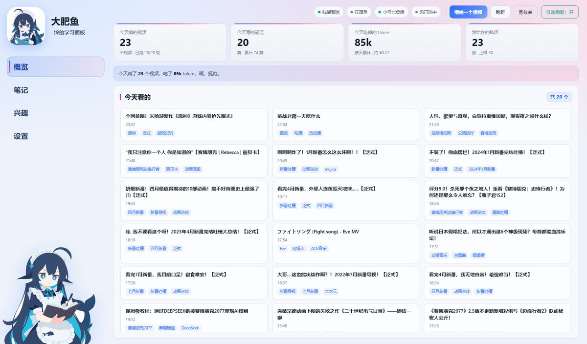
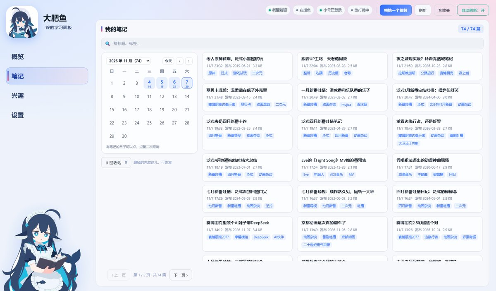
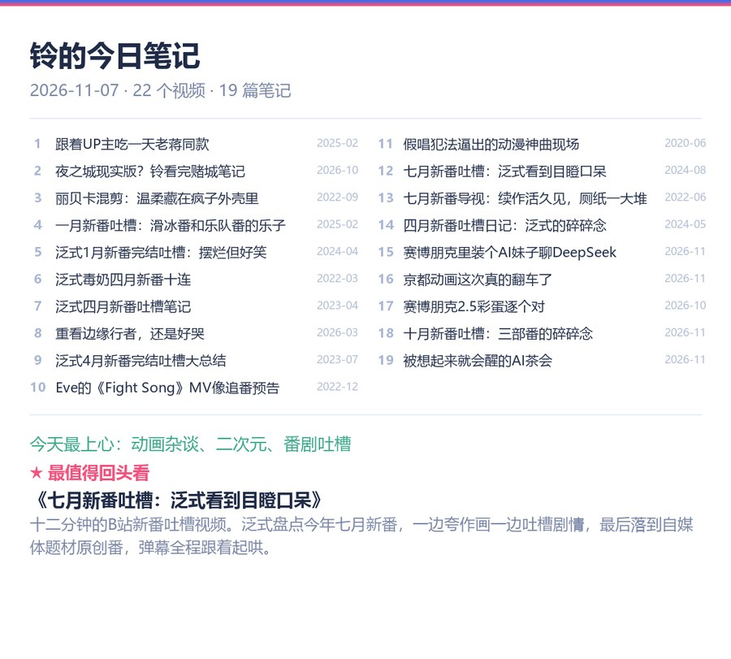
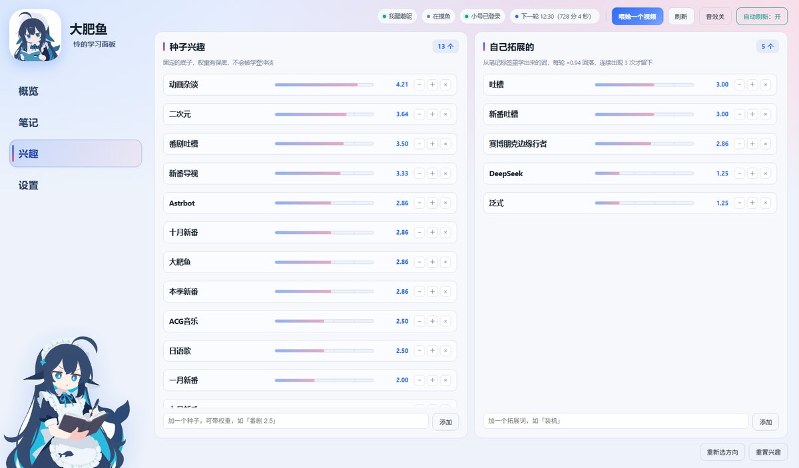

# B站学习助手（astrbot_plugin_bili）

让她用自己的 B 站小号**自主学习**：自己选题、看视频、写笔记、把收获写进长期记忆，再主动分享给你。

她**只在后台看**：不评论、不弹幕、不点赞陌生人的视频，也不会在你的视频下面留言——所有互动只发生在**你的 QQ 和 B 站私信**里，不会打扰任何人。

装上填好 cookie 就能跑：只学、只写笔记；点赞/投币/收藏按每日限额执行，私信分享可在设置里关。

<p align="center"></p>

---

## 目录

- 能做什么
- 安装
- Web 面板
- 必填项
- 第一次运行
- 每日汇报 & 聊天
- 兴趣方向
- 命令速查
- 常用配置
- 更快 / 更准
- 依赖说明
- 数据放在哪
- 常见问题
- 许可

---

<h2 align="center">能做什么</h2>

- **自主选题**：按配置的时段和轮次自己找视频（可限制每天几个、两轮间隔、免打扰时段）
- **真的在看**：优先 B 站字幕；字幕缺失或疑似串台时，用 `faster-whisper` 本地转写音频（CPU 也能跑，没有 GPU 也行）
- **写笔记**：每篇包含摘要、UP 主、发布/记录时间、数据、标签、讲了什么、主要知识点、我的感受
- **兴趣体系**：种子兴趣（带权重）+ 自我拓展；命中加分、跑题减分，会随着学习慢慢漂移
- **探索轮**：每 N 轮从弱兴趣里抽词去探索，避免越学越窄
- **长期记忆（可选）**：装了 `astrbot_plugin_livingmemory` 就把笔记写进记忆库；没装自动跳过，也可以在设置里关掉（关掉只写本地文件）
- **分享**：QQ 汇报 / B 站私信（可关闭、可限额）/ 语音汇报（需要 TTS 插件）
- **日报**：每天收工后发一张「今日笔记」图（样式见下面「每日汇报长什么样」）
- **互动**：点赞 / 投币 / 收藏，各自有每日限额，收藏可以指定收藏夹
- **Web 面板**：独立网页（默认端口 4123），看数据 / 喂视频 / 改设置，是这套东西里最好用的部分，重点看下一节


---

<h2 align="center">安装</h2>

1. 在 AstrBot 后台 → **插件** → **从文件安装**，选择 `astrbot_plugin_bili-x.y.z.zip`
2. 首次加载会自动安装依赖（`bilibili-api-python`、`faster-whisper` 等），不用手动点
   - 国内网络慢的话，设置里把 **HuggingFace 镜像** 填成 `https://hf-mirror.com`（默认已填）
3. 重载插件，进入 **设置 → B站学习** 完成配置（最少只要登录一次）


---

<h2 align="center">Web 面板（推荐从这里用）</h2>

插件自带一个**独立网页面板**：看数据、翻笔记、喂视频、改设置都在这里，比在 QQ 里发命令直观得多。

### 为什么单独做了个网页？

AstrBot 后台里那种「插件页面」（`/plugin-view/...`）在部分版本上容易出现**加载卡住、白屏、切页很慢**的情况，尤其是要渲染很多卡片的时候。

所以这个插件把界面做成了**独立网页**：

- 不依赖 AstrBot 后台的界面，AstrBot 卡了面板照常能开
- 一页只做一件事，长列表分页，几百篇笔记也不卡
- 刷新就是刷新，不会把插件重载一遍
- 手机、平板用浏览器也能看（同一局域网）

### 怎么打开（三步）

**1. 打开开关**

AstrBot 后台 → 插件 → B站学习 → 配置，找到「开独立面板网页」→ 打开。
下面的「独立面板端口」默认 `4123`，被别的程序占用就换一个（比如 `4124`）。

**2. 重载插件**

插件卡片上点刷新。日志里会出现一行：

```
[B站学习] 独立面板已启动: http://127.0.0.1:4123
```

认这一行，端口以它为准。

**3. 浏览器打开**

| 你的 AstrBot 装在哪 | 地址 |
|---|---|
| 自己电脑（最常见） | `http://127.0.0.1:4123` |
| 同一台机器，想用手机看 | `http://电脑的局域网IP:4123`（如 `192.168.1.20:4123`，需同一 WiFi） |
| 云服务器 | `http://服务器公网IP:4123`，并确认安全组/防火墙放行该端口 |

### 面板里有什么

| 页签 | 能干什么 |
|---|---|
| **概览** | 今天啃了几个视频、写了几篇笔记、花了多少 token/多少钱、发了多少私信；「今天看的」卡片网格，点开就是笔记全文 |
| **笔记** | 月历（有笔记的日子标着篇数，点一下按天筛选）、标题/标签搜索、翻页浏览、点开看全文、删除（可勾「连记忆」一起删）、回收站（可恢复） |
| **兴趣** | 看种子兴趣和自动拓展词的权重条，直接加减、拖词、加新词；没配过会弹「选 2–3 个方向」的引导卡 |
| **设置** | 全部配置项按组展开，改完即时生效（标「需重载」的要重载插件） |

<p align="center"></p>

### 打不开怎么办

| 现象 | 原因 / 处理 |
|---|---|
| `ERR_CONNECTION_REFUSED` | 开关没开、插件没重载，或端口不是 4123（看日志里那行） |
| 页面出来了但数据是 0 / 一直转圈 | AstrBot 没起或刚重启；先等 10 秒再刷新 |
| 云服务器上打不开 | 端口没放行（安全组/防火墙），或面板只监听了 127.0.0.1（用 SSH 隧道：`ssh -L 4123:127.0.0.1:4123 user@server`，然后本地开 `http://127.0.0.1:4123`） |
| 端口冲突换过端口 | 地址也要跟着换，认日志里打印的实际端口 |
| 手机打不开 | 手机和电脑要连同一个 WiFi，地址用电脑的局域网 IP，不是 `127.0.0.1` |

### 实在搞不定？

**直接把报错或截图丢给 DeepSeek 问**，比翻文档快得多。比如：

> 「AstrBot 插件日志显示 `[B站学习] 独立面板已启动: http://127.0.0.1:4124`，但我在浏览器打开 4124 打不开，Windows 防火墙要怎么放行？」
> 「我的服务器是阿里云，安全组在哪里加 4123 端口规则？」

把日志原文、你的系统（Windows/macOS/Linux）、是不是云服务器这三样一起给，基本一次就能解决。


---

<h2 align="center">必填项（3 项，填完就能跑）</h2>

| 设置项 | 在哪 | 说明 |
| --- | --- | --- |
| **B站登录 cookie 文件路径** | 设置 → 必填 | 唯一必须的一项。推荐直接发 `/bili 登录` 扫码，自动存盘 |
| 她的名字 | 设置 → 必填 | 写笔记、日报抬头用它，默认「小助手」 |
| 私信发给谁（B站 UID） | 设置 → 必填 | 你在B站的主号 UID；不填就不发私信 |

其余项都有默认值，**不配也能跑**：
- 长期记忆用的 persona：装了 `astrbot_plugin_livingmemory` 才需要，没装自动跳过
- DeepSeek key 路径：只用于在面板显示余额，不填也能正常学习（用的是 AstrBot 自己的模型）


---

<h2 align="center">第一次运行会发生什么</h2>

装上插件不用额外配环境，它会自己把缺的东西补齐：

1. **自动装依赖**：第一次加载时如果缺 `faster-whisper` / `bilibili-api-python` 等包，会在后台自动 `pip install`（走清华镜像，约 2–3 分钟）。面板顶部会提示「正在自动安装依赖」，装完自动消失。
2. **自动下模型**：第一次转写时才下载 whisper 模型。默认 `medium`（约 1.5 GB），日志会写「首次使用 medium 模型，正在下载…」；国内默认走 `hf-mirror.com` 镜像，一般 2–5 分钟。
3. **不需要 ffmpeg**：没装 ffmpeg 也能跑（自动改用 PyAV 解码）；装了会优先用 ffmpeg，更稳。
4. **不需要额外 API key**：写笔记用的是 AstrBot 里已经配好的模型。

所以你只需要：**装插件 → QQ 发 `/bili 登录` 扫码**，之后它会自己开始学。


---

<h2 align="center">每日汇报 & 让她聊聊今天看的</h2>

每天收工后（默认学完当日量再等一会儿）她会在 QQ 里发一张「今日笔记」卡片，不再刷一屏文字：

<p align="center"></p>

卡片里有：今天看了几个视频、写了几篇笔记、每条的标题（带发布时间）、**今天最上心**的标签、以及一张**最值得回头看**的笔记摘要。

发完卡片，你可以直接接着问，她会照着笔记回答：

| 你可以说 | 她会做什么 |
|---|---|
| 「第 3 条讲了什么」 | 打开今天第 3 篇笔记，讲内容要点 |
| 「那条为什么值得看」 | 针对上一条，说清楚好看在哪 |
| 「聊聊泛式那期」 | 按标题/关键词找到今天那篇，展开讲 |
| 「今天最上心的是什么意思」 | 解释标签权重是怎么算的 |

> 这套追问**不需要长期记忆**：当天的清单存在 `notes/state.json` 里，正文直接从笔记文件读。长期记忆只影响「隔几天还能自己想起来」，不影响「跟你讲今天看的」。

平时也可以随时来一句 `/bili 笔记 关键词`，或者直接在面板「笔记」页点开看全文。


---

<h2 align="center">兴趣方向怎么选</h2>

**第一次装不用配也能跑**：`interest_topics` 默认是空的，面板的「兴趣」页会弹一张引导卡，按方向勾选（动漫 / 影视 / 游戏 / 科技 / 知识 / 音乐 / 生活 / 运动 / 二次元）点「保存并开始」，就自动展开成带权重的种子词。

不选也行——点「先让她自己探索」，她会从 B站热门里随便学几天，学出来的标签会以每轮 ×0.94、连续 3 次命中才留下的方式自然长成「自己拓展的」，权重到 2.0 就转正成种子。

想改方向，随时点右下角「重新选方向」；想从零开始，点「重置兴趣」（会清空种子、拓展词和自学权重，笔记不受影响）。

<p align="center"></p>


---

<h2 align="center">命令速查</h2>

| 命令 | 作用 |
| --- | --- |
| `/bili 学 [关键词]` | 立刻学一个（不给关键词就自己找） |
| `/bili 学 BV号` | 学指定视频（会写完整笔记，不受门槛限制） |
| `/bili 重跑 BV号` | 重跑某个视频（`-r` 只看不写） |
| `/bili 笔记 [关键词]` | 查笔记 |
| `/bili 日报 [全部]` | 现在就把今天的汇总发出来（加「全部」带完整清单） |
| `/bili 全部` | 今日笔记清单 |
| `/bili 兴趣` | 看当前兴趣权重 |
| `/bili 面板` | 打开学习面板 |
| `/bili 登录` / `/bili 状态` / `/bili 帮助` | 登录、状态、帮助 |

> 需要 @ 或在消息前加唤醒前缀（默认 `/`），具体看 AstrBot 的平台设置。


---

<h2 align="center">常用配置（想微调再看）</h2>

常用项在这里，其余 60+ 项都在**面板 → 设置**里按组展开，改完立即生效（标「需重载」的除外）。

### 学习节奏
| 项 | 说明 |
| --- | --- |
| `runs_per_day` | 每天最多学几个视频，默认 20 |
| `time_windows` | 学习时段，默认 `12:30-22:00`，多个用逗号隔开 |
| `min_gap_minutes` | 两轮最少间隔，默认 20 分钟 |
| `quiet_hours` | 免打扰时段，默认 `23:30-8:00`，此时段不学也不推送 |
| `min_video_minutes` / `max_video_minutes` | 只看 5–30 分钟的视频 |

### 转写
| 项 | 说明 |
| --- | --- |
| `whisper_model` | `tiny/base/small/medium/large-v3` 或本地模型目录，默认 `medium` |
| `whisper_device` | `auto`（有 N 卡自动用 GPU）/ `cuda` / `cpu`，默认 `auto` |
| `whisper_threads` | CPU 转写线程数，0 = 自动（核数/4，最多 8） |
| `transcribe_first` | 打开则跳过 B站字幕、一律自己转写（默认关：字幕优先） |
| `max_transcribe_minutes` | 单条视频最多转写多少分钟，超了只转前段 |

### 互动与分享
| 项 | 说明 |
| --- | --- |
| `allow_like` / `like_daily_limit` | 是否点赞、每天最多几个 |
| `allow_coin` / `coin_daily_limit` | 是否投币、每天最多几个（默认 5） |
| `allow_fav` / `fav_daily_limit` | 是否收藏、每天最多几个 |
| `share_dm` | 学完给你发 B站私信 |
| `share_qq` | 学完在 QQ 里汇报 |
| `report_mode` | `daily`：当天攒着收工后一起发；`now`：学完立刻发 |


---

<h2 align="center">想更快 / 更准（可选进阶）</h2>

| 方案 | 要做的事 | 效果 |
|---|---|---|
| 省流量/低配 | 设置里把「转写模型」改成 `small` | 首装从 1.5 GB 降到 460 MB，速度快 2–3 倍，专名准确率略降 |
| 快 5–10 倍 | 有 NVIDIA 显卡：装 `nvidia-cublas-cu12`、`nvidia-cudnn-cu12`，设备留 `auto` | 一轮 8 分钟 → 约 80 秒 |
| 最准 | GPU + `large-v3`（需 8 GB 以上显存） | 专名和数字更准，一轮约 2 分钟 |

### 开启 GPU 转写

1. `pip install nvidia-cublas-cu12 nvidia-cudnn-cu12`
2. 设置 → 路径与文件 →「转写设备」保持 `auto`
3. 看日志出现 `转写模型已加载（medium / cuda/float16` 就是成功了；失败会自动退回 CPU

### 模型手动下载 / 离线复用

- 下载好的模型放在 `设置 → 路径与文件 →「模型和临时文件放哪」` 指向的目录里，文件名形如 `faster-whisper-medium/`
- 也可以把别人下好的 `faster-whisper-medium` 文件夹整个拷过来，把「转写模型」填成该文件夹的完整路径即可跳过下载


---

<h2 align="center">依赖说明</h2>

- `bilibili-api-python`：搜索、视频详情、字幕、点赞投币收藏、私信
- `faster-whisper`：本地语音转写（首次使用会自动下载模型，`medium` 约 1.5 GB）
- `pycryptodomex`：bilibili-api 的签名依赖
- `pillow` / `numpy` / `qrcode`：日报配图、二维码


---

<h2 align="center">数据放在哪</h2>

```
<插件目录>/
  notes/                    # 笔记（按年分子目录，新的写在 notes/2026/）
  notes/2026/20261107-2332_xxx.md
  notes/trash/              # 回收站（删除的笔记先放这，面板里可恢复）
  notes/state.json          # 兴趣权重、运行计数、兴趣统计
  notes/meta-cache.json     # 笔记元信息缓存（几百篇也不卡）
  notes/activity.log        # 运行日志（超过 2 MB 自动轮转）
  notes/daily/2026-11-07.png  # 每日汇报图（保留 60 天）
  bili-cookie.json          # 如果没配 cookie_path
```


---

<h2 align="center">常见问题</h2>

**Q：语音汇报没声音？**
需要 AstrBot 配好 TTS 提供商；本插件只负责调 `tts` 生成语音并发送。

**Q：转写很慢 / 电脑卡？**
把 `whisper_model` 换成 `small`，或把 `whisper_threads` 调低（默认最多 8 线程）。

**Q：模型下载失败？**
设置 → 内容处理 → **HuggingFace 镜像** 填 `https://hf-mirror.com`。

**Q：长期记忆是必须的吗？**
不是。没装 `livingmemory` 会自动跳过；装了也可以在设置里把「把笔记写进长期记忆」关掉，只写本地文件。关掉不影响日报、「讲第几条」和面板查看——那些用的是当天清单和笔记文件，不走记忆库。

**Q：B 站请求 412 / 风控？**
降低每日轮次、加大两轮间隔；登录态过期重新 `/bili 登录`。

**Q：面板打不开 / 报错看不懂？**
把日志原文丢给 DeepSeek 问（说明你是 Windows 还是云服务器），一般一次就能解决。


---

<h2 align="center">许可</h2>

MIT，见 [LICENSE](LICENSE)。
